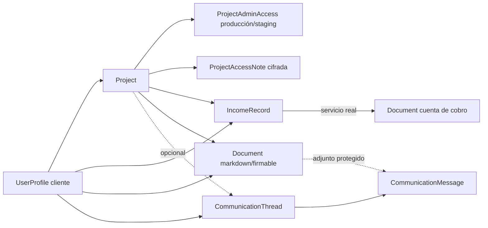

# Cobertura de datos de prueba — ProjectApp

Este documento es el contrato operativo de los datos simulados. El objetivo no
es tener registros decorativos, sino un ambiente de desarrollo que permita
probar paginación, filtros, totales, relaciones, fechas y casos extremos antes
de publicar.

## Comando canónico

```bash
cd backend
python manage.py create_fake_data \
  --settings=projectapp.settings_dev \
  --replace \
  --count 60 \
  --seed 20260826 \
  --anchor-date 2026-08-26
```

La salida imprime el comando de reproducción exacto. `--count 60` es el perfil
representativo; el alias posicional (`create_fake_data 60`) se conserva para la
skill `fake-data-refresh`.

- `--seed` controla cada secuencia aleatoria por módulo. Cada seeder recibe un
  stream independiente, así que agregar consumo aleatorio en Blog no altera
  Documentos o Comunicaciones. También deriva los UUID públicos de propuestas,
  diagnósticos, documentos, share links, Linktrees, QR y entregas de correo.
- `--anchor-date` fija el reloj de negocio. Debe incluirse al reproducir un caso
  en otra máquina; todas las fechas pasadas, vigentes y futuras se calculan a
  partir de ella.
- `--replace` elimina el dataset de desarrollo antes de recrearlo. Sin ese flag,
  el orquestador se niega a acumular otro grafo si encuentra datos simulados o
  raíces de negocio existentes.
- `--skip-accounting` requiere `--skip-documents`: las cuentas de cobro se crean
  desde ingresos reales del dataset y nunca pueden quedar sin entidad de origen.
- Toda la ejecución está dentro de una sola transacción. Si un seeder falla, no
  queda un ambiente parcialmente poblado y `manage.py` termina con código no
  cero.

## Aislamiento y credenciales

Cada comando de fake data, incluido `delete_fake_data`, llama por sí mismo al
guard compartido. Sólo se ejecuta cuando el settings module declara literalmente
`FAKE_DATA_ALLOWED = True` y `IS_PRODUCTION` no está activo.

- `projectapp.settings_dev`: habilitado y forzado a SQLite.
- `projectapp.settings` y `projectapp.settings_prod`: deshabilitado.
- Producción no puede habilitarlo por `DEBUG`, `DJANGO_ENV`, nombre del host ni
  una convención de nombre de base de datos.
- Pytest habilita la capacidad explícitamente sobre su base aislada de test.

No se crean contraseñas conocidas para cuentas de usuario. Los usuarios demo
reciben contraseña inutilizable salvo que el operador suministre
`SEED_ADMIN_PASSWORD`, `SEED_CLIENT_PASSWORD` o `DEMO_CLIENT_PASSWORD` de forma
explícita. El detalle de cada proyecto sí recibe credenciales operativas
marcadas `demo-only`, cifradas con `PROJECT_ACCESS_CIPHER_KEY` y ligadas sólo a
hosts reservados `.example.test`; sirven para probar reveal/copy sin parecer
secretos reales.

`delete_fake_data --confirm` es un reset de desarrollo: elimina contenido,
proyectos y usuarios no staff. Preserva cuentas staff/superuser, catálogos y
filas contables importadas o manuales; sólo borra contabilidad marcada con
`source_ref="fake:accounting"`.

## Perfil representativo por defecto

Los valores son objetivos mínimos o perfiles deliberados, no repartos uniformes.

| Módulo / entidad raíz | Objetivo con `--count 60` | Distribución relevante |
|---|---:|---|
| Clientes | ≥60 + perfiles QA y Enlaces seguros | 30 sin proyecto, 20 con uno, 9 con tres y 1 con veinte |
| Proyectos | ≥67 + casos QA y Enlaces seguros | seis estados vigentes: desarrollo, activo, evolución, suspensión, cierre correcto y baja definitiva; casos vacíos y hosting separados |
| Accesos de proyecto | 2 ambientes + 2 notas por proyecto representativo | producción y staging por cada proyecto; URL/admin/usuario/password cifrada, una nota ordinaria y una sensible con contenido cifrado |
| Requerimientos del proyecto de carga | 60 | todos los estados Kanban y prioridades |
| Entregables del proyecto de carga | ≥60 | seis categorías y archivados; recurso QA adicional con tres versiones y PDFs locales válidos; los recursos lógicos sin archivo mantienen versión 1 |
| Solicitudes de cambio del proyecto de carga | 60 | seis estados, urgentes/no urgentes y costos grandes |
| Bugs del proyecto de carga | 60 | ocho estados, cuatro severidades y tres ambientes |
| Notificaciones | 60 | seis tipos y mezcla leídas/no leídas |
| Contactos | 60 | contenido Faker determinista |
| Propuestas | ≥60 | todos los estados, clientes reales y una propuesta de título extremo; las negociadas y aceptadas traen datos de contrato completos (incluidos los tres del servicio) y alternan cierre con contrato único o con producto y servicio |
| Blog | 60 | publicadas/borrador, categorías, JSON y fechas escalonadas |
| Portafolio | 60 | bilingüe y mezcla publicado/borrador |
| Tareas | 60 | tableros, prioridades, estados, alertas y comentarios |
| Diagnósticos | 61 | 60 del listado + un caso histórico convertido a propuesta |
| Ingresos esperados/perdidos | ≥63 raíces + ingreso grande pendiente QA | esperados, líquidos, perdidos; pendientes, parciales y pagados; candidatos de cobro verdes, naranjas, rojos y sin clasificar |
| Gastos | 60 | personales/negocio y fechas pasadas, actuales y futuras |
| Hosting contable | 45 | 0–4 ciclos, vencidos, vigentes y futuros |
| Documentos | ≥60 | todos con cliente/proyecto; con y sin carpeta; 2 firmables |
| Cuentas de cobro | 40 | creadas desde `IncomeRecord` por el servicio real; draft sin carpeta y issued/paid/overdue/cancelled bajo la jerarquía automática por proyecto, año y mes |
| Hilos de comunicación | 60 | 12 de 1 mensaje, 36 de 3 y 12 de 12; 264 mensajes |
| Preferencias de comunicaciones | 1 por admin demo | navegación por clientes, orden alfabético, 50 hilos, correo y ancho no predeterminados |
| Linktrees / botones | 12 / 48 | activos/inactivos, personal/empresa |
| Tarjetas QR | 30 | URL/Linktree, activas/inactivas y nombre extremo |
| Publicaciones LinkedIn | 20 | draft/scheduled/published/failed |
| Historial de correo | ≥60 | estados de entrega, clientes y fechas escalonadas |
| Historial MCP | 60 | conectores demo inactivos, eventos exitosos/fallidos, sin credenciales reales |
| Monitoreo | 2 recursos, 2 fuentes, 120 casos y 2 reportes | estados y severidades completos; sin credenciales ni ingestiones reales |
| Enlaces seguros | 27 ejemplos Panel/MCP/públicos + 10 de Plataforma | tipos, estados, sustitución y carpetas; tokens aleatorios cifrados, sin salidas externas |

Los catálogos (`DocumentType`, estados, plantillas, defaults, paquetes de horas,
settings singleton) se aseguran o se reutilizan; no se inflan artificialmente a
60 porque su cardinalidad pertenece al dominio.

## Integridad entre módulos



- Todo ingreso tiene cliente; cuando lleva proyecto, ese proyecto pertenece al
  mismo cliente.
- Todo proyecto del dataset tiene exactamente los dos ambientes de acceso y dos
  notas representativas. Passwords y contenidos se guardan como Fernet, nunca
  como los valores demo en claro.
- Las cuentas comerciales creadas desde ingreso conservan `income_record` y
  heredan su cliente y proyecto. Las cuentas históricas de hosting conservan
  `hosting_record`; dos tienen contexto explícito y una queda pendiente de
  asociación para probar conciliación. No se les inventa un ingreso. La creación usa `create_income_collection_account`, no escritura
  paralela por ORM.
- Todo documento del generador representativo tiene cliente y proyecto. La mitad
  de cada familia queda sin carpeta para probar ambos filtros.
- Todo hilo tiene cliente. El proyecto y los documentos adjuntos sólo se eligen
  dentro de ese mismo cliente.
- Hosting, ciclos y totales conservan sus equivalencias; abonos parciales y el
  abono compartido mantienen la suma de hijos contra su movimiento de bolsillo.

## Casos extremos intencionales

- nombres de cliente, proyecto, propuesta, documento, hilo y QR largos sin
  espacios;
- montos cercanos al máximo representable;
- un cliente con veinte proyectos y un tercio de los hilos;
- hilos de un mensaje y conversaciones de doce mensajes, con replies, draft,
  failed, corrección de fecha, anulación y cierre;
- documentos con/sin carpeta, firmados/sin firmar y cuentas en todos los estados;
- fechas vencidas, vigentes y futuras en ingresos, gastos, hosting, proyectos,
  comunicaciones y publicaciones programadas.

## Cobertura de modelos y mantenimiento

`content.fake_data` clasifica cada modelo concreto de `accounts`, `content`,
`monitoring` y `secure_links` en
una de cuatro categorías:

- `SEEDED_MODELS`: raíz creada o asegurada por un seeder;
- `DERIVED_MODELS`: filas creadas a través de la raíz o de servicios reales;
- `CATALOG_MODELS`: catálogo de cardinalidad fija, asegurado por migración o
  configuración;
- `EXEMPT_MODELS`: secretos, comprobantes de proveedores, operaciones de retención,
  aprobaciones y material efímero que exige una acción explícita; cada grupo
  tiene su justificación en el contrato. No se fabrican para llenar tablas.

El test `test_model_contract_classifies_every_concrete_business_model` compara
esa clasificación con el app registry de Django. Un modelo nuevo deja el test en
rojo hasta que la misma entrega:

1. defina su volumen o justifique que es derivado/catálogo/exento;
2. agregue datos coherentes al seeder responsable;
3. añada una aserción observable de relaciones/distribución cuando corresponda;
4. actualice esta matriz si introduce una entidad visible.

La regla es parte de Definition of Done: un modelo visible nuevo sin datos de
prueba no está completo.

## Verificación ejecutable

El contrato focal vive en
`backend/content/tests/management/test_fake_data_contract.py`. Los casos existentes y las regresiones de PA-231
comprueban el guard positivo, el inventario de modelos, el replay de semilla,
los volúmenes y sesgos, la integridad cliente/proyecto/origen, las distribuciones
temporales y de comunicaciones, el rollback atómico y el reemplazo completo.
Debe ejecutarse en lotes de máximo 20 tests, de acuerdo con la política del
repositorio; un cambio de seeder no se considera completo si este contrato queda
rojo o si el gate de calidad lo clasifica como no mergeable.

## Comandos parciales

Todos aceptan `--seed` y `--anchor-date` y aplican el mismo guard de entorno.

| Área | Comando responsable |
|---|---|
| Clientes/proyectos extremos | `create_fake_clients_projects` |
| Plataforma base | `seed_platform_data` |
| Volumen y derivados de plataforma | `enrich_platform_data` |
| Clientes de estados especiales | `seed_demo_clients` |
| Propuestas / paquetes | `create_fake_proposals`, `create_fake_hour_packages` |
| Blog / portafolio / tareas / diagnósticos | `create_fake_blog_posts`, `create_fake_portfolio`, `create_fake_tasks`, `create_fake_diagnostics` |
| Contabilidad / hosting | `create_fake_accounting` |
| Documentos / cuentas de cobro | `create_fake_documents` |
| Comunicaciones | `create_fake_communications` |
| Email / QR / Linktree / LinkedIn / MCP | `create_fake_auxiliary` |
| Casos QA identificables | `create_fake_platform_cases` (después de `seed_platform_data`) |
| Monitoreo | `create_fake_monitoring` |
| Enlaces seguros | `create_fake_secure_links` |
| Limpieza | `delete_fake_data --confirm` |

Las preparaciones de formalización y sus archivos privados son efímeros y se
clasifican como EXEMPT: los recorridos de prueba los generan desde propuestas
representativas mediante la API, sin sembrar envíos reutilizables.


## PA-231 — Matriz observable por módulo

El perfil habitual incorpora estos casos sin flags adicionales. «Generado»
se acredita por las pruebas focales del escenario, no por registrar su modelo.
Los IDs numéricos pueden cambiar al reemplazar; buscar por los nombres siguientes.
SU = superusuario, STAFF = personal del Panel, A = administrador de Plataforma,
C = cliente propietario. Los catálogos conservan su cardinalidad del dominio.

| Módulo / escenario | Rol | Relaciones y estado inicial | Preparación / localizador | Clasificación |
|---|---|---|---|---|
| Identidades y permisos | SU/STAFF/A/C | Staff y superusuario diferenciados; admin de Plataforma sin staff | `create_fake_platform_cases`; `qa-superuser`, `qa-staff`, `qa-admin` con dominio `@example.test` | Generado; contraseñas inutilizables |
| Cliente sin proyectos | C | Completo, verificado, sin proyectos propios | `qa-empty@example.test` | Generado |
| Proyecto vacío | C/A | Dueño del proyecto base; sin recursos ni documentos de negocio; conserva las raíces automáticas del dominio | `[QA] Proyecto vacío` | Generado |
| Aislamiento entre clientes | C | Cliente limitado dueño de otro proyecto; sin acceso al recurso del primero | `qa-limited@example.test`; `[QA] Proyecto de otro cliente` | Generado |
| Onboarding y perfil | C | Pendiente sin verificar; verificado con perfil incompleto | `qa-pending@example.test`, `qa-profile@example.test` | Generado; OTP se obtiene por el flujo normal |
| Clientes/proyectos: volumen y extremos | A/STAFF | Sin proyecto, uno, varios y carga alta; nombres sin espacios; ciclo de vida vigente | `create_fake_clients_projects --count 60`; `ClienteExtremo`, `ProyectoExtremadamenteLargo` | Generado |
| Recursos y adjuntos | A/C | PDF actual v3; versiones 1/2/3 con bytes distintos y descargables; adjuntos y cargas del cliente locales | `[QA] Recurso PDF con tres versiones`; `enrich_platform_data` | Brecha corregida: antes había rutas sin archivo y PDFs placeholder |
| Seguimiento/entregas | A/C | Contrato y otrosí firmados de demostración → alcance/fases/etapas/publicación/requerimientos; decisiones parciales y etapa interna | `seed_platform_data`; proyecto base con guías de validación | Generado mediante helpers de dominio |
| Bugs y solicitudes | A/C | Proyecto, autor, estados y prioridades del dominio; comentarios internos/públicos | `seed_platform_data` + `enrich_platform_data`; títulos `[Volume]` | Generado |
| Ideas y accesos | A/C | Proyecto del propietario; ideas activas/archivadas y colección; política sin concesión automática | `create_fake_clients_projects`; ideas de evaluación futura | Generado; no otorga permisos adicionales |
| Contabilidad → cuenta → pago | SU | Ingreso del mismo cliente/proyecto; cuenta draft/issued/paid/overdue/cancelled; pagos y movimientos coherentes | `create_fake_accounting` → `create_fake_documents`; buscar cuenta y su ingreso de origen | Generado mediante servicios reales |
| Importe grande pendiente | SU | Esperado sin abono; reparto exacto entre socios; proyecto y cliente coinciden | `[QA] Ingreso grande pendiente`, 987654321012 COP | Brecha corregida: el extremo anterior ya estaba liquidado |
| Hosting conciliado / por vincular | SU | Origen contable y suscripción; dos cuentas históricas asociadas y tercera sin contexto | `[Demo] Hosting periódico 1/2/3`; helper de billing del orquestador | Generado; origen hosting válido, distinto de ingreso |
| Suscripción y pagos | A/C | Proyectos separados para active/pending/suspended/cancelled; pagos en todos los estados | `[QA] Hosting <estado>`; `[QA] Pago <estado>` | Generado, sin pasarela |
| Documentos extensos | STAFF/C | Markdown y representación estructurada; párrafos, palabra larga y tabla de cinco columnas | `[QA] Documento largo de referencia` | Brecha corregida: preparación responsive externa |
| Documentos/carpetas/hilos | STAFF/C | Cliente y proyecto coherentes; con/sin carpeta, firmas sintéticas, episodios y notas; hilos documentales transversales explícitos | `create_fake_documents`; `Entrega, revisión y aprobación` | Generado; los hilos transversales no son conversaciones privadas |
| Comunicaciones | STAFF | Cliente; proyecto y adjuntos de ese cliente; 1/3/12 mensajes, borradores, fallos, correcciones y cierre | `create_fake_communications`; títulos de conversaciones del seed | Generado |
| Propuestas/diagnósticos/paquetes | STAFF | Cliente real del dataset, estados, secciones, versiones y precios | `create_fake_proposals`, `create_fake_diagnostics`, `create_fake_hour_packages` | Generado; no dispara formalizaciones externas |
| Financiación | STAFF | Cliente, propuesta/proyecto opcionales y plantilla; ciclo de vida y segundo ciclo | `create_fake_financing`; referencias `Contrato DEMO-` | Generado; PDF de muestra válido, sin valor contractual |
| Contactos/blog/portafolio/tareas | STAFF | Contenido bilingüe, categorías, borrador/publicado; tableros, alertas y comentarios | `create_contacts`, `create_fake_blog_posts`, `create_fake_portfolio`, `create_fake_tasks` | Generado |
| Email/QR/Linktree/LinkedIn/MCP | STAFF/SU | Historial ficticio, enlaces reservados, estados variados, conectores inactivos | `create_fake_auxiliary`; prefijos demo | Generado; historial no acredita transporte o publicación |
| Monitoreo | SU | Recurso→fuente→caso→nota; pendiente/revisión/resuelto; resuelto implica condición recuperada | `create_fake_monitoring`; recursos `demo-server`, `demo-project` | Brecha corregida: integrado y fechado por ancla |
| Enlaces seguros | STAFF/C | Propietario/proyecto, audiencia, tipos, estados, carpetas y sustitución | `create_fake_secure_links`; `[Demo] Enlace QA`, `Demo 1/2` | Brecha corregida: integrado, repetible sin duplicados |
| OTP, OAuth, IA/voz, pasarela, correo real | Según flujo | Requiere acciones efímeras o proveedor de pruebas autorizado | Preparación puntual del flujo y destino de prueba | Exento de siembra; nunca fabricar éxito externo |
| Retención/integridad/aprobaciones | SU | La operación requiere previsualización y confirmación explícitas | Ejecutar el flujo en una copia desechable del dataset | Preparación puntual; no insertar recibos ficticios |

## Preparación aislada desde cero

1. Elegir un SHA de código y exportarlo a un directorio desechable propio, fuera
   del clon de deploy y del worktree de sesión. No copiar `.env`, bases vivas ni
   sesiones. Las migraciones de esa copia las ejecuta su responsable, nunca
   desde el worktree con el entorno enlazado del despliegue.
2. Usar una configuración exclusiva que no lea `.env`: SQLite en esa carpeta,
   `IS_PRODUCTION=False`, `FAKE_DATA_ALLOWED=True`, caché local, Huey en memoria
   inmediato, correo capturado localmente y almacenamiento público/privado/backups
   dentro de la misma carpeta. Cada alias de storage debe apuntar allí. Usar claves
   privadas propias; sus valores no se imprimen ni forman parte de la guía.
3. Aplicar las migraciones de la copia y ejecutar el comando canónico con
   `--settings=<configuración aislada> --count 60 --seed 20260826
   --anchor-date 2026-11-06`. Añadir `--replace` sólo para un reemplazo autorizado.
4. Guardar junto a la base el SHA, configuración usada (sin secretos), volumen,
   semilla, ancla y flags omitidos. La salida del comando reproduce también los
   flags `--skip-*`. Repetir con el mismo corte; una fecha nueva produce otro
   estado temporal aunque la semilla coincida.
5. Las cuentas QA tienen contraseña inutilizable: habilitar el acceso mediante
   los mecanismos normales del entorno aislado. No se crean rutas de acceso que
   eludan autenticación ni se imprimen tokens, contraseñas o URL de revelación.

Las fechas almacenadas se reproducen. Los estados calculados respecto de «ahora»
(vencimientos, salud de fuentes y enlaces) envejecen: para repetirlos exactamente
usar el mismo reloj de referencia en CI; para QA actual elegir una ancla actual
antes del caso. Tokens, cifrado Fernet, nombres físicos asignados por storage,
PKs y timestamps automáticos de auditoría no son valores de negocio reproducibles.
Los archivos de recursos contienen bytes reales; no se requiere ningún proveedor
para descargarlos. Las portadas remotas históricas de Blog/Portafolio son URLs,
no archivos locales ni prueba de disponibilidad de un tercero.

## Reemplazo, fallos y comprobación

El reset sigue siendo completo para las raíces de desarrollo y preserva staff,
catálogos y contabilidad manual/importada. Monitoreo limpia sólo sus dos recursos
y fuentes demo; los enlaces QA llevan marcadores propios, y los independientes
se conservan aunque hayan sido movidos a una carpeta demo. No usar `--replace`
sobre una campaña QA activa ni sobre una base con información que deba conservarse.

La transacción de fake data reutiliza la limpieza diferida del dominio: los
archivos viejos se eliminan después del commit y sólo si ninguna fila los sigue
usando. Si falla la siembra, se restaura la base anterior y se limpian los archivos
nuevos ya registrados, conservando los referenciados por las filas restauradas.
No equivale a recuperación frente a caída del proceso o del sistema operativo.

`Fake data contract` ejecuta en CI el contrato existente, los escenarios de PA-231,
las regresiones de carpetas de Enlaces seguros y los contextos de billing. Reparte
los casos en cuatro jobs, con lotes de veinte como máximo y resultados JUnit como
artefactos. No se ejecutan pruebas automatizadas locales. La evidencia de entrega
identifica la URL de la corrida, el SHA probado y su conclusión; el verde de CI no
acredita entregas reales de correo, pagos, OAuth ni proveedores externos.
